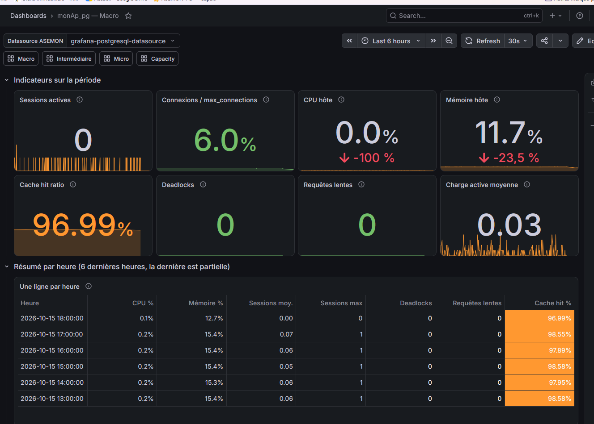
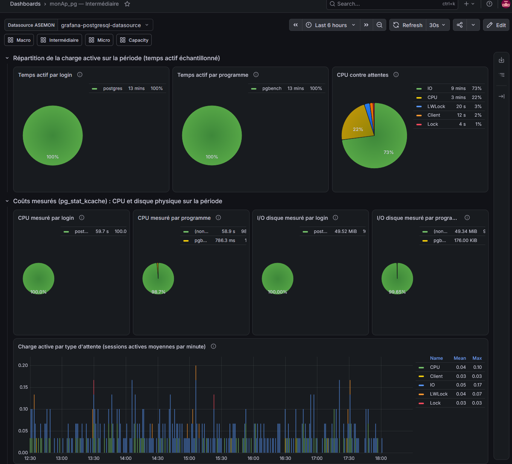
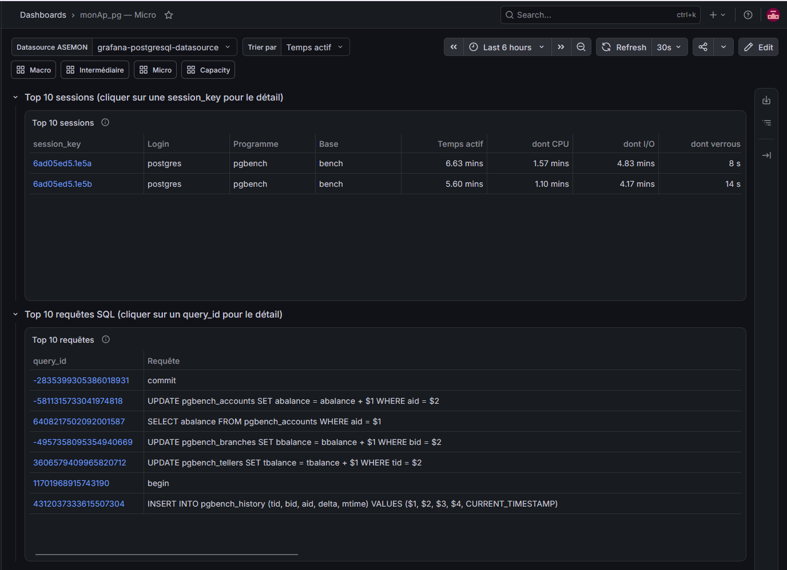
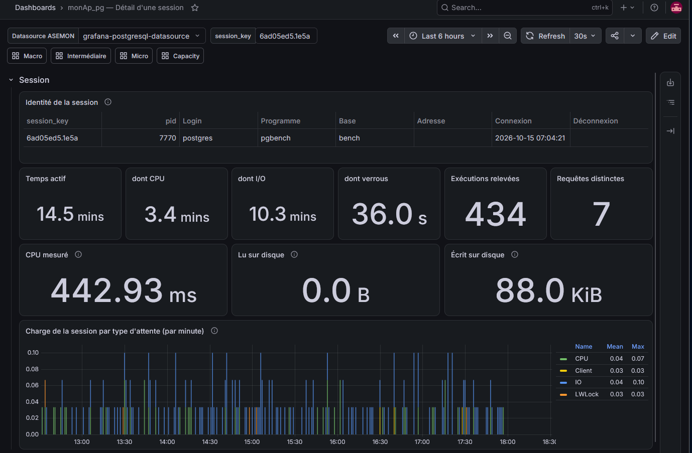
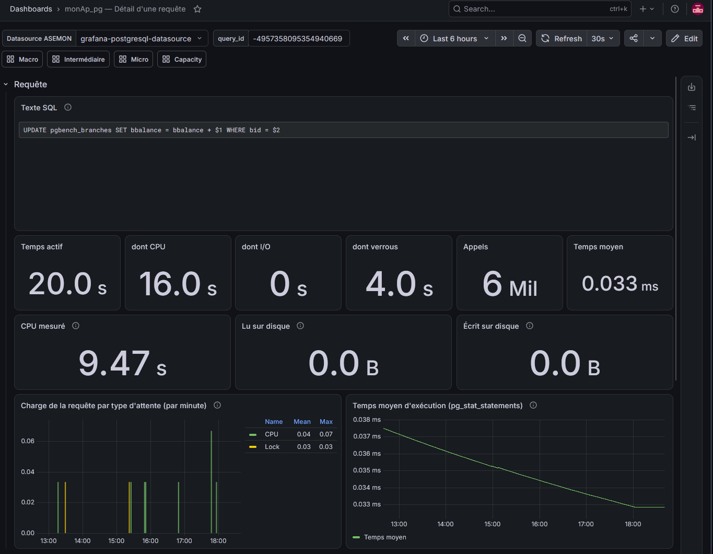
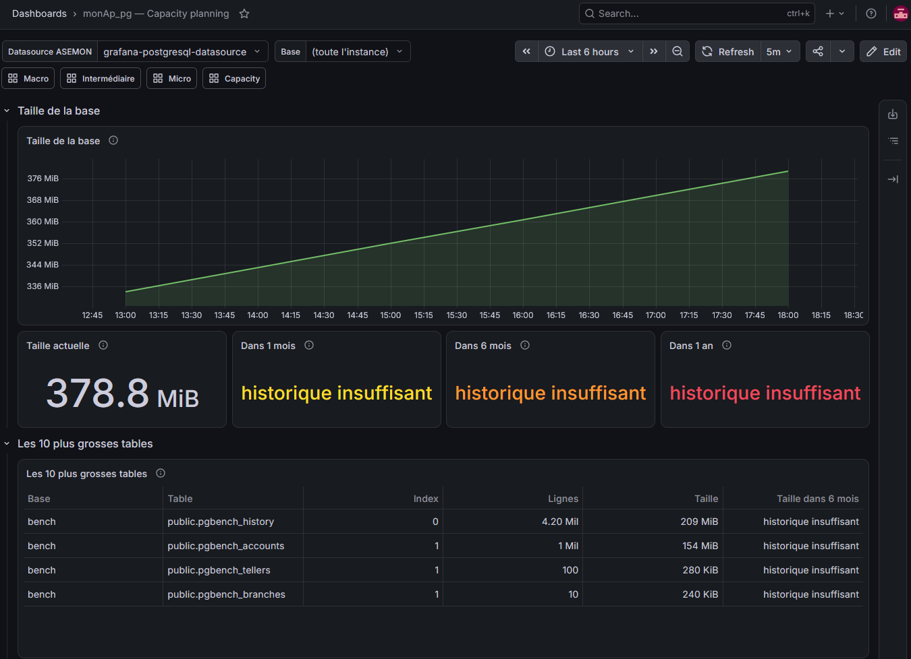

# Guide pas à pas : des machines virtuelles aux dashboards

> **À lire en premier.** Ce guide suit une seule ligne droite : créer deux machines virtuelles sous Hyper-V, installer monAp_pg, générer de l'activité, puis contrôler les résultats dans Grafana. Compter **1 h 30 environ**, dont une bonne part d'attente (installations).
>
> **Statut (2026-10-15).** Le guide couvre la **Release 4** (plusieurs instances, seuils d'alarme, pages Parc et Instance). Les étapes 1 à 3 et 8 à 9 reprennent ce qui a été fait et validé sur le POC. Les étapes 4 à 7 utilisent les **scripts d'installation, qui n'ont pas encore été essayés sur des machines neuves** (`docs/15-installation-scriptee.md`). Si un script échoue, copier la sortie du terminal et passer au dépannage (§10) ; la procédure manuelle, validée, est dans les fiches `docs/01` à `docs/14`.
>
> Les adresses (`192.168.1.28`, `192.168.1.30`), l'utilisateur `admin01` et le dossier `/opt/asemon` sont ceux du POC : à adapter.

---

## 0. Ce qu'on va construire

Deux machines virtuelles Ubuntu sur le même réseau :

- **VM-Monitoring** : le *repository* (base PostgreSQL `monitoring`, qui garde l'historique) et **Grafana** (les écrans).
- **VM-Cible** : l'instance PostgreSQL **surveillée**, et les trois programmes Python qui la mesurent (collecteur, échantillonneur, lecteur de journaux).

Chaque machine surveillée est une **instance** dans le repository (« VM-Cible », « VM-Monitoring »…). Le guide n'en installe qu'une ; pour en ajouter d'autres, y compris VM-Monitoring elle-même, voir [19-multi-instance.md](19-multi-instance.md) et [20-supervision-vm-monitoring.md](20-supervision-vm-monitoring.md).

La VM-Cible envoie ses mesures à la VM-Monitoring. Grafana les affiche. Schémas détaillés : [00-architecture.md](00-architecture.md).

### Ce qu'il faut avant de commencer

- Un PC **Windows 11 Pro** (ou Enterprise, Education) : Hyper-V n'existe pas sous Windows Famille.
- **12 Go de RAM libres** pour les deux machines (6 Go chacune), 80 Go de disque.
- Une connexion Internet (téléchargements, paquets Ubuntu, PostgreSQL, Grafana).
- Un terminal Windows (PowerShell) pour se connecter en SSH.

---

## 1. Préparer Hyper-V (sur Windows)

**1.1 Activer Hyper-V** (PowerShell en administrateur), puis redémarrer le PC :

```powershell
Enable-WindowsOptionalFeature -Online -FeatureName Microsoft-Hyper-V -All
```

**1.2 Créer le commutateur réseau.** Gestionnaire Hyper-V > **Gestionnaire de commutateur virtuel** > Nouveau commutateur virtuel :
- Nom : `Monitoring-Switch`
- Type : **Réseau externe**, lié à la carte réseau du PC
- Cocher **Autoriser le système d'exploitation de gestion à partager cette carte réseau**

Les deux VM utiliseront **ce même commutateur** : sinon elles ne se voient pas. Un commutateur externe leur donne une adresse sur votre réseau local (DHCP).

**1.3 Télécharger Ubuntu Server 26.04 LTS** sur <https://ubuntu.com/download/server> (fichier `ubuntu-26.04.1-live-server-amd64.iso`) et le ranger dans `C:\ISO\`.

---

## 2. Créer les deux machines virtuelles

Faire les mêmes gestes deux fois :

| | Première VM | Deuxième VM |
|---|---|---|
| Nom Hyper-V | `VM-Monitoring` | `VM-Cible` |
| Nom du serveur Ubuntu | `vmmonitoring` | `vmcible` |
| Disque | 40 Go | 20 à 40 Go |

**2.1 Création.** Gestionnaire Hyper-V > **Création rapide…**
1. Choisir **Source d'installation locale** (la galerie intégrée propose souvent d'anciennes versions d'Ubuntu).
2. Parcourir jusqu'à l'ISO de `C:\ISO\`.
3. Donner le nom de la VM.
4. **Autres options** : réseau `Monitoring-Switch`.
5. **Créer**, mais **ne pas démarrer** tout de suite.

**2.2 Fixer la mémoire (important).** Clic droit sur la VM > **Paramètres** :
- **Mémoire** : décocher *Activer la mémoire dynamique*, fixer **6144 Mo**.
- **Processeur** : 2 processeurs virtuels (recommandé).

> La mémoire dynamique d'Hyper-V provoque des plantages (« System is deadlocked on memory ») et des processus tués pendant les installations. À régler **avant** de démarrer.

**2.3 Installer Ubuntu.** Démarrer la VM, **Se connecter**, puis suivre l'installeur :
1. Langue et clavier : **French**.
2. Type d'installation : **Ubuntu Server**.
3. Réseau : laisser le DHCP.
4. Stockage : proposition par défaut (disque entier).
5. Profil : nom du serveur (`vmmonitoring` ou `vmcible`), utilisateur `admin01`, un mot de passe.
6. **Cocher « Install OpenSSH server »** (sinon, voir `docs/01-VM-Monitoring.md` §1.7).
7. Ne choisir aucun « featured snap ».
8. Attendre la fin, **Reboot Now**, retirer l'ISO si demandé.

Au premier affichage de l'écran de connexion, relever l'adresse IP (ou taper `ip -br a` après connexion).

> **La VM refuse de démarrer sur l'ISO** (erreur de démarrage sécurisé) : éteindre la VM, Paramètres > **Sécurité** > modèle de démarrage sécurisé **Autorité de certification UEFI Microsoft**, puis redémarrer.

**2.4 Fixer l'adresse IP de VM-Monitoring.** L'adresse de VM-Monitoring sera écrite dans la configuration de VM-Cible : si le DHCP la change, la collecte s'arrête sans bruit. Le plus simple : une **réservation DHCP** dans le routeur. L'adresse MAC de la VM s'obtient avec :

```powershell
Get-VMNetworkAdapter -VMName VM-Monitoring | Select-Object VMName, MacAddress
```

Noter les deux adresses IP : `IP_MONITORING` et `IP_CIBLE`.

---

## 3. Se connecter en SSH et mettre à jour

Le copier-coller ne marche pas dans la fenêtre Hyper-V : tout le reste se fait **en SSH depuis PowerShell**, un onglet par VM.

```powershell
ssh admin01@IP_MONITORING
ssh admin01@IP_CIBLE
```

Sur **chaque** VM :

```bash
sudo apt update && sudo apt upgrade -y
sudo apt install -y git
```

Vérifier que les deux machines se voient. Depuis VM-Cible :

```bash
ping -c 3 IP_MONITORING
```

Les trois réponses doivent arriver. Sinon : même commutateur ? même réseau ?

---

## 4. Récupérer le projet sur les deux VM

**Option A : cloner le dépôt** (si GitHub est accessible depuis la VM) :

```bash
git clone https://github.com/serentz/monAp_pg.git
cd monAp_pg
```

**Option B : copier le dossier depuis le PC** (depuis PowerShell, une fois par VM) :

```powershell
scp -r C:\chemin\vers\monAp_pg admin01@IP_MONITORING:~/
scp -r C:\chemin\vers\monAp_pg admin01@IP_CIBLE:~/
```

Puis, sur chaque VM, remettre les droits et les fins de ligne du dépôt (le transfert Windows les abîme) :

```bash
cd ~/monAp_pg
git checkout -- .
```

> Si Git répond « not a git repository » (dossier copié sans `.git`) : `sed -i 's/\r$//' scripts/*.sh python/*.py` puis lancer les scripts avec `sudo bash` (c'est ce qu'utilise ce guide).

---

## 5. Remplir le fichier de paramètres

Sur **chaque VM**, depuis le dossier du projet :

```bash
cp scripts/asemon.env.example scripts/asemon.env
nano scripts/asemon.env
```

(`nano` : écrire, puis `Ctrl+O`, `Entrée`, `Ctrl+X`.) Les **mêmes valeurs sur les deux VM**. Le fichier commence par les comptes et mots de passe :

| Variable | À mettre |
|---|---|
| `COLLECTOR_PASSWORD` | un mot de passe, au choix |
| `GRAFANA_RO_PASSWORD` | un autre mot de passe |
| `ASEMON_COLLECT_PASSWORD` | un troisième mot de passe |
| `GRAFANA_THRESHOLDS_PASSWORD` | un quatrième mot de passe : compte qui modifie les seuils depuis Grafana (vide = page des seuils en lecture seule) |
| `GRAFANA_ADMIN_PASSWORD` | le mot de passe voulu pour Grafana (vide = rien n'est configuré) |
| `SERVICE_USER` | `admin01` |
| `MONITORING_IP` | `IP_MONITORING` |
| `SUBNET` | votre réseau, par exemple `192.168.1.0/24` |

Les mots de passe : 8 caractères minimum, lettres, chiffres et `. _ @ % + = -` seulement (pas d'espace ni de guillemet). Ce fichier n'est jamais versionné.

---

## 6. Installer VM-Monitoring (d'abord)

Toujours **VM-Monitoring avant VM-Cible** : la base doit exister avant que la collecte y écrive.

```bash
cd ~/monAp_pg
sudo bash ./scripts/install-monitoring.sh
```

Compter 5 à 10 minutes. Le script installe PostgreSQL 17, crée la base `monitoring` et ses tables, les comptes, trois minuteurs (rollup et calcul des indicateurs toutes les 5 minutes, partitions, rétention), Grafana et ses deux plugins (panneaux texte et formulaire), puis, si `GRAFANA_ADMIN_PASSWORD` est renseigné, crée les sources de données (dont « ASEMON Seuils » si `GRAFANA_THRESHOLDS_PASSWORD` est renseigné) et importe les 10 dashboards.

Contrôle :

```bash
sudo bash ./scripts/verify.sh monitoring
```

Toutes les lignes doivent être vertes. Ouvrir ensuite **`http://IP_MONITORING:3000`** dans le navigateur du PC (identifiant `admin`, mot de passe `GRAFANA_ADMIN_PASSWORD`) : le menu **Dashboards** liste les dix dashboards monAp_pg, encore vides.

---

## 7. Installer VM-Cible

```bash
cd ~/monAp_pg
sudo bash ./scripts/install-target.sh
```

Compter 5 à 10 minutes. Le script installe PostgreSQL 17 et `pg_stat_kcache`, règle PostgreSQL pour la supervision (journaux JSON, plans lents, `lc_messages = 'C'`), **redémarre PostgreSQL** (quelques secondes), crée le compte de lecture, installe l'application dans `/opt/asemon` et démarre trois services : `asemon-collector`, `asemon-sampler`, `asemon-logparser`.

Attendre **une minute**, puis :

```bash
sudo bash ./scripts/verify.sh target
```

Sur **VM-Monitoring**, les compteurs de lignes doivent monter :

```bash
sudo bash ./scripts/verify.sh monitoring
```

(la ligne « Données reçues » affiche le nombre de lignes de `snap_os`, `snap_activity`, `snap_statements`, etc.).

---

## 8. Générer de l'activité

Un POC sans charge n'affiche presque rien. Sur **VM-Cible**.

**8.1 Charge classique** (base `bench`, environ 3 minutes) :

```bash
cd /tmp
sudo -u postgres createdb bench
sudo -u postgres pgbench -i -s 10 bench
sudo -u postgres pgbench -c 4 -T 120 bench
```

Elle alimente les sessions, les coûts CPU et disque, les verrous.

**8.2 Requêtes lentes** (pour les plans d'exécution, environ 2 minutes) :

```bash
cd ~/monAp_pg
sudo bash ./scripts/charge-lente.sh 120
```

Les requêtes de plus de 100 ms sont enregistrées avec leur plan.

**8.3 Un interblocage (optionnel)** : deux transactions qui se bloquent mutuellement, PostgreSQL en annule une.

```bash
cd /tmp
sudo -u postgres psql -d bench -c "DROP TABLE IF EXISTS dl; CREATE TABLE dl(id int primary key, v int); INSERT INTO dl VALUES (1,0),(2,0);"
sudo -u postgres psql -d bench -c "BEGIN; UPDATE dl SET v=1 WHERE id=1; SELECT pg_sleep(2); UPDATE dl SET v=1 WHERE id=2; COMMIT;" > /dev/null 2>&1 &
sleep 0.3
sudo -u postgres psql -d bench -c "BEGIN; UPDATE dl SET v=2 WHERE id=2; SELECT pg_sleep(2); UPDATE dl SET v=2 WHERE id=1; COMMIT;"
```

Un message « deadlock detected » doit apparaître : c'est le résultat attendu.

---

## 9. Contrôler les résultats

Ouvrir `http://IP_MONITORING:3000` > **Dashboards**. Régler la période en haut à droite sur **Last 30 minutes** (ou *Last 1 hour*) : sur une installation neuve, la période par défaut de 6 heures est presque vide. Les heures affichées sont celles du navigateur ; la base stocke l'UTC.

Les captures de référence sont dans [images/Release_3](../images/Release_3/README.md) ; vos valeurs seront différentes, la forme doit ressembler.

### 9.0 monAp_pg — Parc et Instance (Release 4)

Les deux premiers boutons de la barre de navigation. Les mesures des indicateurs sont calculées toutes les 5 minutes : attendre ce délai après l'installation.

**Parc** (`/d/asemon-fleet`) : une ligne par instance surveillée, avec son indicateur le plus problématique, sa valeur, ses seuils et son état (OK, avertissement, alarme, sans mesure récente). Trois tuiles en haut comptent les instances par état. Cliquer le nom d'une instance propose sa page **Instance** ou sa **Macro**.

À contrôler :
- une ligne pour VM-Cible, état **OK** (vert), indicateur et valeur renseignés ;
- le graphe de gravité (100 % = seuil d'alarme) ne commence qu'à l'installation : quelques points au début, c'est normal.

**Instance** (`/d/asemon-instance`) : choisir l'instance dans la variable **Instance**. Le haut montre l'état actuel des 6 indicateurs ; le bas donne une ligne par heure sur les 3 dernières heures (pic de CPU et son heure, attente de verrou maximale, deadlocks, transactions ouvertes, disque libre minimal, transaction la plus longue). Après l'étape 8.3, la ligne de l'heure en cours montre le deadlock.

La variable **Instance** est conservée quand on passe d'une page à l'autre avec la barre de navigation. Détails : [22-parc-et-instance.md](22-parc-et-instance.md).

### 9.1 monAp_pg — Macro



À contrôler :
- les huit tuiles ont une valeur (sessions actives, connexions, CPU, mémoire, cache, deadlocks, requêtes lentes, charge active) ;
- **Deadlocks** vaut au moins 1 si l'étape 8.3 a été faite (tuile rouge) ;
- le tableau « une ligne par heure » a une ligne pour l'heure en cours (la première ligne apparaît après environ 5 minutes).

### 9.2 monAp_pg — Intermédiaire



À contrôler :
- les camemberts de répartition du temps actif par **login** et par **programme** montrent `pgbench` ;
- les **coûts mesurés** (CPU et disque par login et par programme) ont des valeurs non nulles après le `pgbench` ; une part « (non attribué) » est normale (requêtes plus courtes que 2 secondes) ;
- les courbes système (CPU, mémoire, réseau, disque, WAL) sont tracées.

### 9.3 monAp_pg — Micro



À contrôler :
- le **top 10 des sessions** et le **top 10 des requêtes** sont remplis ; la variable **Trier par** change l'ordre ;
- cliquer sur une `session_key` ouvre le détail de la session, cliquer sur un `query_id` ouvre le détail de la requête.

### 9.4 Détail d'une session



À contrôler : identité (login, programme), temps actif ventilé en CPU, I/O et verrous, coûts mesurés, une ligne par exécution, et dessous les plans et interblocages de la session.

### 9.5 Détail d'une requête (plans lisibles)

Ouvrir le Micro, trier les requêtes par durée, cliquer sur le `query_id` d'une requête issue de `charge-lente.sh` (par exemple une jointure sur `pgbench_accounts`).



À contrôler :
- la boîte **Texte SQL** montre la requête indentée, 10 lignes visibles avec ascenseur ;
- la boîte **Plan d'exécution affiché** montre l'arbre du plan, 15 lignes visibles avec ascenseur (`Hash Join`, `Seq Scan`, coûts, temps réels) ;
- le tableau **Plans (auto_explain)** liste les plans de la requête (au plus 5 par heure) ; cliquer sur un **N°** affiche ce plan dans la boîte.

### 9.5 bis Capacity planning

Ouvrir **Capacity** dans la barre de navigation (ou `/d/asemon-capacity`). La période par défaut est de 30 jours.



À contrôler :
- le graphe montre la taille de la base choisie dans la variable **Base** (ou `(toute l'instance)`) ;
- la tuile **Taille actuelle** est renseignée dès la première collecte ;
- **Dans 1 mois**, **Dans 6 mois** et **Dans 1 an** affichent « historique insuffisant » pendant les 48 premières heures, puis une valeur extrapolée ;
- le tableau liste les 10 plus grosses tables (nombre d'index, lignes estimées, taille, taille dans 6 mois) avec un ascenseur.

Détails : [18-capacity-planning.md](18-capacity-planning.md).

### 9.5 ter Seuils

Ouvrir **Seuils** dans la barre de navigation. Les deux tableaux donnent l'état actuel de chaque indicateur et les seuils en vigueur (défauts : CPU 80 % / 95 %, disque libre 20 % / 10 %, attente de verrou 30 s / 120 s, transaction la plus longue 5 min / 30 min, deadlocks 1 / 5 par heure).

Pour modifier un seuil, utiliser le formulaire **Modifier un seuil** en bas de la page (instance `0` = défaut de toutes les instances), ou en SQL :

```sql
SELECT asemon.set_threshold(NULL, 'cpu_pct', 80, 95);   -- défaut de toutes les instances
SELECT asemon.reset_threshold(1, 'cpu_pct');            -- retour au défaut pour l'instance 1
```

Le nouvel état apparaît au prochain calcul (5 minutes au plus). Détails et pièges : [21-seuils.md](21-seuils.md).

### 9.6 Contrôle direct dans la base (sur VM-Monitoring)

```bash
sudo -u postgres psql -d monitoring
```

```sql
SELECT count(*) FROM asemon.snap_samples;      -- échantillons toutes les 2 s : doit monter
SELECT count(*) FROM asemon.snap_kcache;       -- coûts mesurés
SELECT count(*) FROM asemon.event_plans;       -- plans, après charge-lente.sh
SELECT count(*) FROM asemon.event_deadlocks;   -- 1 ou plus après l'étape 8.3
SELECT * FROM asemon.v_instance_status;        -- état de chaque instance (Release 4)
```

Quitter avec `\q`.

---

## 10. Dépannage

| Symptôme | Cause probable | Action |
|---|---|---|
| Plantage de la VM, `apt` interrompu | mémoire dynamique active | §2.2 |
| `ping` entre les VM impossible | commutateurs différents | même `Monitoring-Switch` pour les deux |
| Un script s'arrête sur « Permission denied » | droits perdus au transfert | `git checkout -- .` ; lancer avec `sudo bash` |
| Script : « postgresql.auto.conf redéfinit … » | un `ALTER SYSTEM` antérieur | `ALTER SYSTEM RESET <paramètre>;` puis relancer |
| Collecteur : timeout / `connection refused` | `MONITORING_IP` ou `SUBNET` faux, IP changée | corriger `asemon.env`, relancer les scripts (VM-Monitoring d'abord) |
| Grafana : HTTP 401 pendant l'installation | mot de passe admin différent | `sudo grafana cli admin reset-admin-password <mdp>` |
| Dashboards vides | données pas encore arrivées, ou source de données en échec | attendre 1 à 2 minutes ; Grafana > Connections > Data sources > *ASEMON Monitoring* > **Save & test** |
| Boîtes SQL / plan vides (« plugin not found ») | plugin non installé | `sudo grafana cli plugins install marcusolsson-dynamictext-panel` puis `sudo systemctl restart grafana-server` |
| Parc : « sans mesure récente » ou état vide | indicateurs calculés toutes les 5 min ; `asemon-rollup.timer` arrêté | attendre 5 min ; `systemctl status asemon-rollup.timer` sur VM-Monitoring |
| Seuils : le formulaire ne change rien | `GRAFANA_THRESHOLDS_PASSWORD` vide à l'installation, source « ASEMON Seuils » absente | [21-seuils.md](21-seuils.md) §7 |
| Peu ou pas de plans | peu de requêtes de plus de 100 ms | étape 8.2 |
| Coûts CPU à zéro | `pg_stat_kcache` inactif | `sudo bash ./scripts/verify.sh target` |

D'autres pièges déjà rencontrés : [README.md](../README.md), section « Pièges déjà rencontrés ». Voir aussi [15-installation-scriptee.md](15-installation-scriptee.md) §6.

---

## 11. Checklist finale

- [ ] Deux VM créées, mémoire fixe à 6144 Mo, même commutateur
- [ ] SSH fonctionne sur les deux, `ping` entre elles
- [ ] `asemon.env` rempli sur les deux
- [ ] `verify.sh monitoring` : tout vert
- [ ] `verify.sh target` : tout vert
- [ ] `pgbench` lancé, `charge-lente.sh` lancé
- [ ] Parc : VM-Cible en état OK ; Instance : 3 lignes horaires
- [ ] Macro, Intermédiaire, Micro : valeurs affichées
- [ ] Capacity et Seuils : tableaux remplis
- [ ] Détail requête : SQL indenté, plan en arbre, clic sur un plan
- [ ] Interblocage visible (optionnel)

## 12. Pour aller plus loin

- Comprendre l'architecture : [00-architecture.md](00-architecture.md)
- Réglages (intervalles, rétention) : section « Réglages courants » du [README](../README.md)
- Installation à la main, étape par étape : fiches `01` à `14` (index dans le README)
- Plans lisibles : [17-plans-v2.1.md](17-plans-v2.1.md)
- Plusieurs instances : [19-multi-instance.md](19-multi-instance.md) ; supervision de VM-Monitoring : [20-supervision-vm-monitoring.md](20-supervision-vm-monitoring.md)
- Seuils : [21-seuils.md](21-seuils.md) ; Parc et Instance : [22-parc-et-instance.md](22-parc-et-instance.md)
- Prochaines releases : [16-roadmap-releases.md](16-roadmap-releases.md)

## 13. Tout supprimer

Éteindre les VM, puis dans PowerShell (administrateur) :

```powershell
Stop-VM -Name VM-Monitoring, VM-Cible -TurnOff
Remove-VM -Name VM-Monitoring, VM-Cible -Force
```

Les disques virtuels (`.vhdx`) restent sur le disque : les supprimer à la main dans le dossier des disques virtuels d'Hyper-V.
